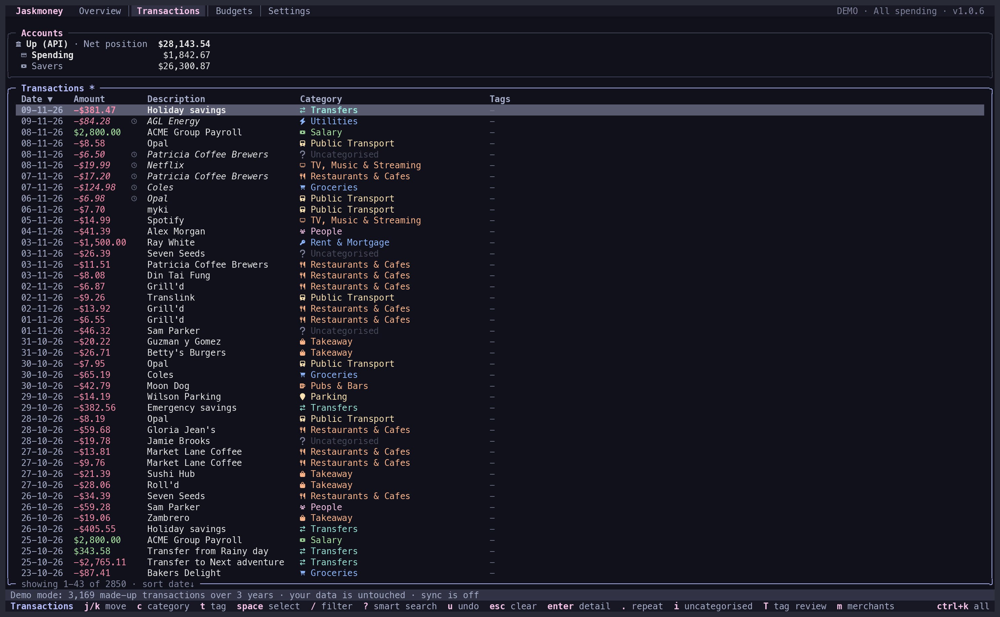
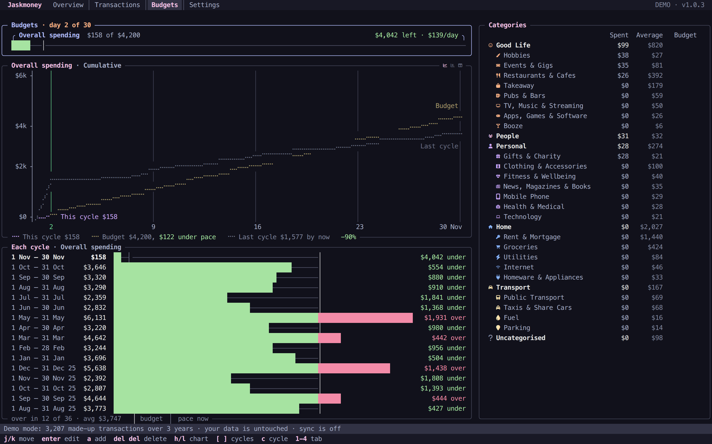
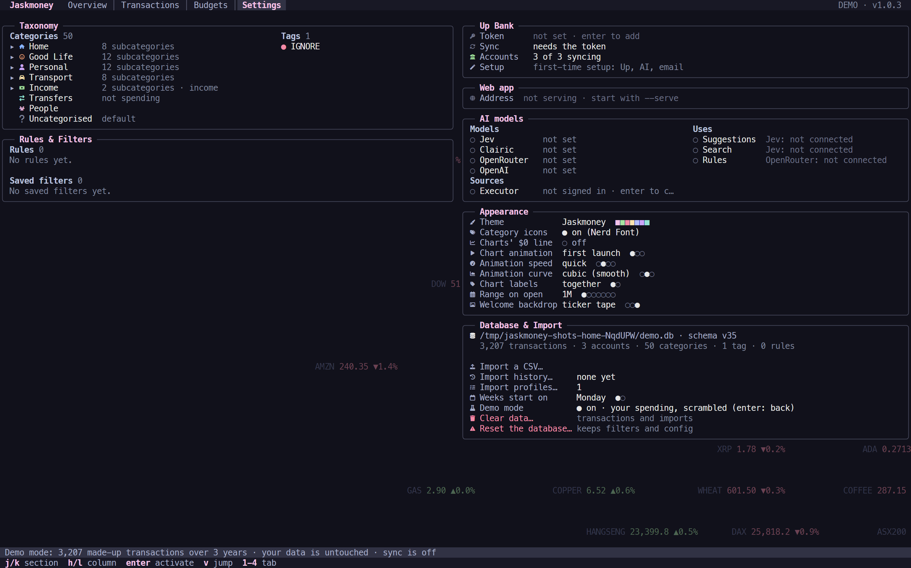

# Jaskmoney

A keyboard-driven personal spending TUI for [Up Bank](https://up.com.au). It syncs your Up accounts, categorises and
tags transactions (both ways with Up), and shows where the money goes against a budget.

https://github.com/user-attachments/assets/a5acf4e8-1cf5-4fc6-9ca6-32ae0252800f

| Transactions | Budgets | Settings |
| --- | --- | --- |
| <a href="docs/screenshots/transactions.png"></a> | <a href="docs/screenshots/budgets.png"></a> | <a href="docs/screenshots/settings.png"></a> |

## Install

```bash
curl -fsSL https://get.jask-aran.com/jaskmoney | bash
```

That serves this repo's [`scripts/install.sh`](scripts/install.sh). To fetch it from GitHub directly instead:

```bash
curl -fsSL https://raw.githubusercontent.com/jask-aran/jaskmoney/main/scripts/install.sh | bash
```

This puts `jaskmoney` in `~/.local/bin`: the release binary on Linux x64 and WSL, a build from source elsewhere (needs
git and [Bun](https://bun.sh) 1.4.2+). `jaskmoney upgrade` updates it; the top bar says when a new release is out.

From a clone: `bun install && bun run build --install` (or `bun start` to run without installing).

`jaskmoney --demo` runs three years of made-up data without touching yours. A [Nerd Font](https://www.nerdfonts.com)
shows the icons; without one, turn icons off in Settings › Appearance.

## Features

- **Up sync**: full history, then every 5 minutes; categories and tags go back to Up.
- **Overview**: spending, income, savings rate and runway for any date range, with charts against your budget's pace.
- **Budgets**: per cycle, split by category or account, against pace and past cycles.
- **Transactions**: filters, saved filters, a merchant view, bulk edits, undo.
- **Categorising**: suggestions from your history and AI, accepted one at a time or all at once; rules offered as you go.
- **Smart search**: ask in words (`?coffee over $5 last month`) and get a filter you can edit.
- **CSV import** for other banks.

## Connect Up

Make a Personal Access Token at <https://api.up.com.au>, then in Jaskmoney press `4` (Settings) › **Up Bank** ›
`enter` on Token and paste it. Sync starts straight away.

AI is optional: Settings › AI models takes a TypeSafe, OpenRouter or OpenAI key (or a browser sign-in), and each use
shows exactly what it sends.

## Your data

Everything lives in `~/.jaskmoney` on your machine (owner-only): the database, settings, your token and keys. It goes
only to the services you set up:

- **Up**: to sync, and to save the categories and tags you set.
- **AI providers** (TypeSafe, OpenRouter, OpenAI, Cloudflare): a transaction's description, amount, type, message and
  category, or your search. Every question asked is in `src/domain/questions.ts`.
- **Executor** (optional): holds your Gmail sign-in and looks up order emails for purchases after each sync. Sign out
  in Settings › Executor; revoke it at executor.sh.

Nothing of yours goes with two other requests: public market prices from Yahoo Finance (the setup's backdrop), and
GitHub's latest release, asked by an installed binary every 10 minutes (`JASKMONEY_NO_UPDATE_CHECK=1` turns it off).
The optional server (`--serve`) trusts every connection from this machine: see
[docs/client-server.md](docs/client-server.md#security).

## Keys

| Key | Does |
| --- | --- |
| `1`–`4` | Overview, Transactions, Budgets, Settings |
| `ctrl+k` | Every command, searchable |
| `/` · `?` | Filter · smart search |
| `c` · `t` | Category · tags |
| `u` | Undo |
| `ctrl+c` | Quit |

The footer lists the keys for where you are; the [guide](docs/guide.md) has the rest.

## In action

The setup's tour, on its made-up data.

**Filter** (`/`): words, `amt:`, `cat:` and `date:`, combined, filtering as you type.

https://github.com/user-attachments/assets/95b3c3a7-ad97-4539-8728-5d47dd851a70

**Smart search** (`?`): ask in words; Jev writes the filter, yours to read and edit.

https://github.com/user-attachments/assets/b08958d2-e4c8-4760-b4c1-82b69b2aff27

**Suggestions**: what Amazon and eBay rows bought, from your order emails, and a category suggested for each row from
that, the merchant and the amount.

https://github.com/user-attachments/assets/7054a134-58a7-4de0-a902-33402e9f9711

**Charts** (`h`/`l`): the Overview's views: spending, cash flow, balances, savers, the calendar and your subscriptions.

https://github.com/user-attachments/assets/211c5c2b-0efe-4e8e-bcce-2413226c27ed

## Development

```bash
bun run dev           # restarts on save
bun run typecheck
bun run test
bun run recordings    # the README's GIFs and screenshots: docs/media.md
bun run screenshots
```

SolidJS on [OpenTUI](https://github.com/sst/opentui), SQLite through `bun:sqlite`. A release: set `version` in
`package.json`, commit, and push a `v*` tag; the Release workflow tests it, builds the Linux binary and publishes it.

## License

Copyright (C) 2026 Jaskaran Singh. [AGPL-3.0-only](LICENSE): use, modify and share it freely; anyone who runs a
modified version as a network service must offer its users the source.
