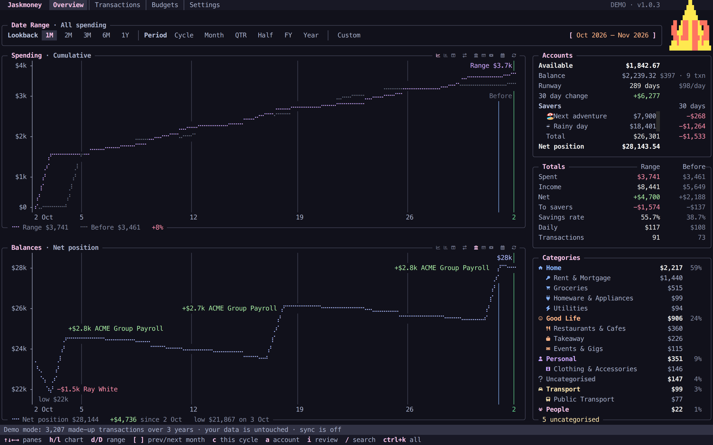

# Jaskmoney

Jaskmoney is a personal spending TUI that works mainly with [Up Bank](https://up.com.au). It syncs your Up accounts,
categorises and tags transactions (both ways with Up), and shows where the money goes against a budget, all from the
keyboard.



## Quick start

```bash
curl -fsSL https://raw.githubusercontent.com/jask-aran/jaskmoney/main/scripts/install.sh | bash
```

This installs the `jaskmoney` command in `~/.local/bin`. On Linux x64 (and WSL) it downloads the latest release's
binary; on macOS and other platforms it builds from source, which needs git and [Bun](https://bun.sh) 1.4.2 or newer
(the clone lives in `~/.local/share/jaskmoney`). `jaskmoney upgrade` updates it the same way. The top bar shows the
version, and turns it green when a new release is out.

Or by hand, in a clone:

```bash
git clone https://github.com/jask-aran/jaskmoney.git && cd jaskmoney
bun install && bun run build --install    # or `bun start` to run without installing
```

A binary built in a clone updates there: `git pull && bun install && bun run build --install`. To try a build without
installing it, `bun run bin` builds and runs `dist/jaskmoney` (`bun run bin --demo` for the demo data).

Screenshots use the built-in demo data: `jaskmoney --demo` (or `bun start --demo`) runs three years of made-up
transactions without touching yours. A [Nerd Font](https://www.nerdfonts.com) shows the category icons; without one,
turn icons off in Settings › Appearance.

## Features

- **Up Bank sync**: full history, then every 5 minutes; categories and tags sync back to Up.
- **Overview**: spending, income, savings rate and runway for any date range, with charts against your budget pace.
- **Budgets**: an overall budget per cycle, split by category or account, tracked against pace and past cycles.
- **Transactions**: instant filters, saved filters, merchant view, bulk edits, undo.
- **Categorising**: suggestions from your history and AI; accept one at a time or all at once; auto-offered rules.
- **Tags**: synced with Up, with trip and subscription detection.
- **Smart search**: ask in words (`?coffee over $5 last month`) and get an editable filter.
- **Keyboard first**: a command palette (`ctrl+k`) and per-pane key hints.
- **CSV import** for other banks.

| Transactions | Budgets |
| --- | --- |
|  |  |

## Connecting Up

1. Create a Personal Access Token at <https://api.up.com.au>.
2. In Jaskmoney, press `4` for Settings, go to **Up Bank**, and press `enter` on the Token row to paste it.

Sync starts straight away. `ctrl+r` syncs on demand, and the Accounts row chooses which accounts sync.

AI features are optional. Settings › AI models takes a TypeSafe or OpenRouter key (or a browser sign-in) for
suggestions and search, and OpenRouter or OpenAI for the rule writer; each use shows exactly what it sends.

## Your data

Your data is stored on your machine in `~/.jaskmoney` (owner-only): the SQLite database, settings, and your token
and keys. It's sent only to the services you set up:

- **Up**, to sync your accounts and to save categories and tags you set back to them.
- **AI providers** (TypeSafe, OpenRouter, OpenAI, Cloudflare): a transaction's description, amount, type, message
  and category, or your search query. Every question asked is in `src/domain/questions.ts`.
- **Executor** (optional): it holds your Gmail sign-in, and after each sync looks up order emails for purchases
  (searching by date and order number) so a transaction can show what was bought. Sign out in Settings › Executor, and
  revoke it at executor.sh.

Two requests carry nothing of yours: the setup's ticker-tape backdrop fetches public market prices from Yahoo Finance,
and an installed binary asks GitHub for the latest release every 10 minutes and when you point at its version
(`JASKMONEY_NO_UPDATE_CHECK=1` turns that off).
Demo mode uses a separate `demo.db` built from made-up data and never syncs.

The optional server (`bun run server`, `--serve`) trusts every connection from this machine: see
[docs/client-server.md](docs/client-server.md#security).

## Keys

| Key | Does |
| --- | --- |
| `1` `2` `3` `4` | Overview, Transactions, Budgets, Settings |
| `ctrl+k` | Command palette: every command, searchable |
| `/` · `?` | Filter · smart search |
| `i` | Review uncategorised rows |
| `c` · `t` | Category · tags for the cursor row or selection |
| `u` · `.` | Undo · repeat the last change |
| `esc` | Step back one level |
| `ctrl+c` | Quit |

The footer always lists the keys for where you are. The [guide](docs/guide.md) covers everything else.


## Development

```bash
bun run dev          # restarts on save
bun run typecheck
bun run test
```

SolidJS on [OpenTUI](https://github.com/sst/opentui), with SQLite through `bun:sqlite`. `docs/` holds the guide, the
client/server split and the backlog.

Releases: set `version` in `package.json`, commit, then tag and push it (`git tag -a v1.1.0 -m "Jaskmoney 1.1.0" &&
git push origin v1.1.0`). The Release workflow tests the tag, builds the Linux x64 binary, and attaches it
to the tag's GitHub release, making it if there isn't one.

## License

Copyright (C) 2026 Jaskaran Singh. Licensed under the [GNU Affero General Public License v3.0 only](LICENSE) (`AGPL-3.0-only`): you may use, modify and share it freely, and anyone who runs a modified version as a network service must offer its users the source.
