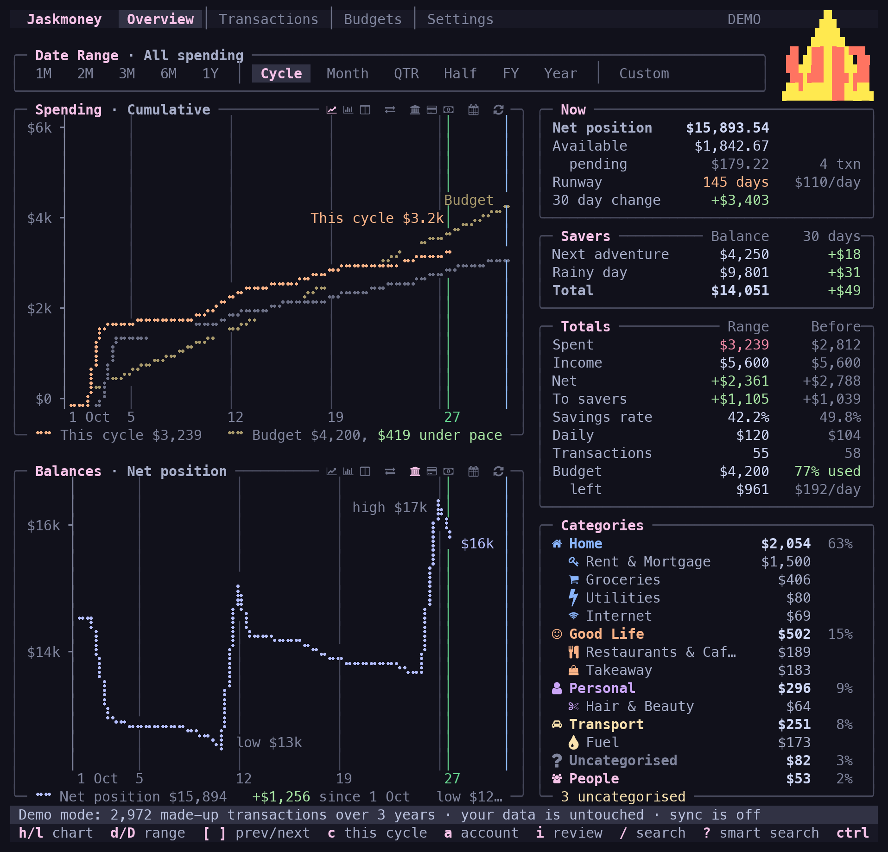
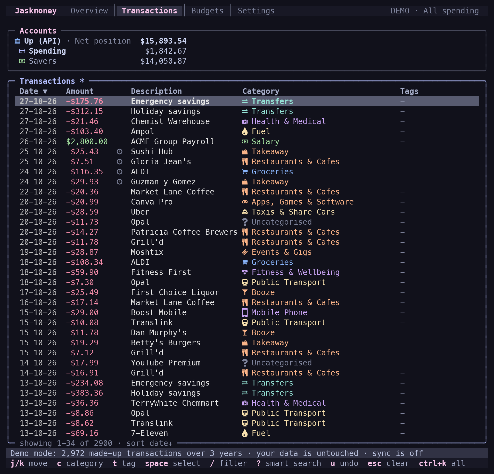
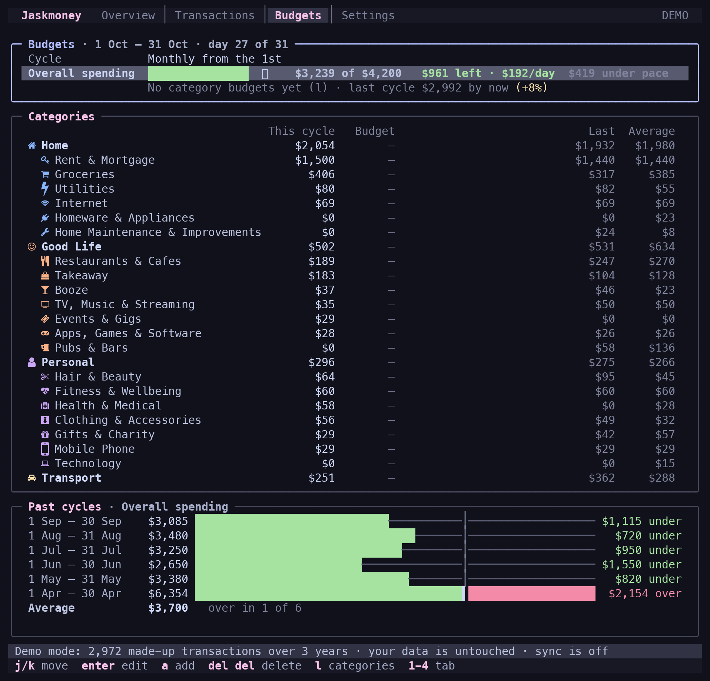
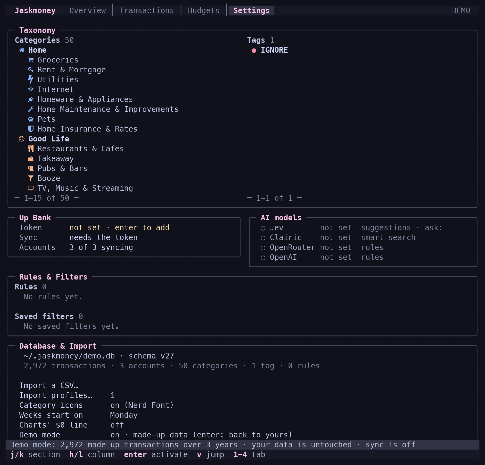

# Jaskmoney

Jaskmoney is a personal spending TUI that works mainly with [Up Bank](https://up.com.au). It syncs your Up accounts,
categorises and tags transactions (both ways with Up), and shows where the money goes against a budget, all from the
keyboard.



## Quick start

Needs [Bun](https://bun.sh) 1.3+.

```bash
git clone https://github.com/jask-aran/jaskmoney.git && cd jaskmoney && bun install && bun start
```

To install the `jaskmoney` command, build a standalone binary and link it onto your PATH (run from the repo):

```bash
bun run build && mkdir -p ~/.local/bin && ln -sf "$PWD/dist/jaskmoney" ~/.local/bin/jaskmoney
```

Screenshots use the built-in demo data: `jaskmoney --demo` (or `bun start --demo`) runs three years of made-up
transactions without touching yours. A [Nerd Font](https://www.nerdfonts.com) shows the category icons; without one,
turn icons off in Settings › Database & Import.

## Features

- **Up Bank sync**: full history, then every 5 minutes; categories and tags sync back to Up.
- **Overview**: spending, income, savings rate and runway for any date range, with charts against your budget pace.
- **Budgets**: an overall budget per cycle, split by category or account, tracked against pace and past cycles.
- **Transactions**: instant filters, saved filters, merchant view, bulk edits, undo.
- **Categorising**: suggestions from your history and AI; accept one at a time or all at once; auto-offered rules.
- **Tags**: synced with Up, with trip and subscription detection.
- **Smart search**: ask in words (`?coffee over $5 last month`) and get an editable filter.
- **Keyboard first**: a command palette (`ctrl+k`) and per-pane key hints.
- **CSV import** for other banks.





## Connecting Up

1. Create a Personal Access Token at <https://api.up.com.au>.
2. In Jaskmoney, press `4` for Settings, go to **Up Bank**, and press `enter` on the Token row to paste it.

Sync starts straight away. `ctrl+r` syncs on demand, and the Accounts row chooses which accounts sync.

AI features are optional. Settings › AI models takes a TypeSafe or OpenRouter key (or a browser sign-in) for
suggestions and search, and OpenRouter or OpenAI for the rule writer.

## Your data

Everything stays on your machine in `~/.jaskmoney` (owner-only): the SQLite database, settings, and your token and
keys. Nothing is sent anywhere except Up, and the AI providers you set up. Those receive a transaction's description,
amount, type, message and category, or your search query; every question asked is in `src/domain/questions.ts`.
Demo mode uses a separate `demo.db` built from made-up data and never syncs.

## Keys

| Key | Does |
| --- | --- |
| `1` `2` `3` `4` | Overview, Transactions, Budgets, Settings |
| `ctrl+k` | Command palette: every command, searchable |
| `/` · `?` | Filter · smart search |
| `i` | Review uncategorised rows |
| `c` · `t` | Category · tags for the cursor row or selection |
| `u` · `.` | Undo · repeat the last change |
| `esc` | Step back one level |
| `q` | Quit |

The footer always lists the keys for where you are. The [guide](docs/guide.md) covers everything else.



## Development

```bash
bun run dev          # restarts on save
bun run typecheck
bun run test
```

SolidJS on [OpenTUI](https://github.com/sst/opentui), with SQLite through `bun:sqlite`. `legacy/go/` holds the
original Go app as a behavioural reference. `docs/` holds the guide, port contracts and frozen captures.
